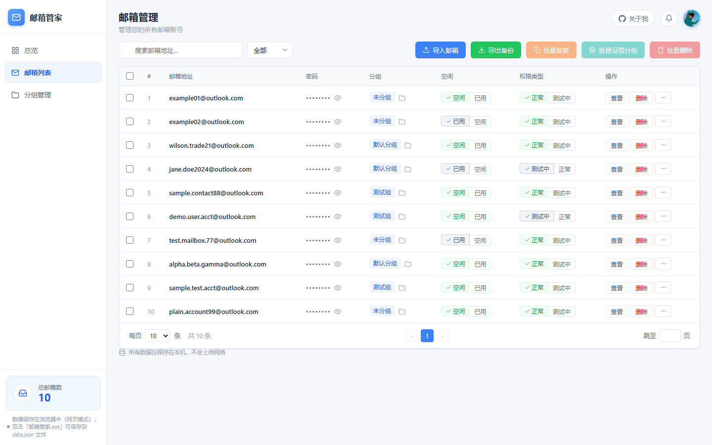
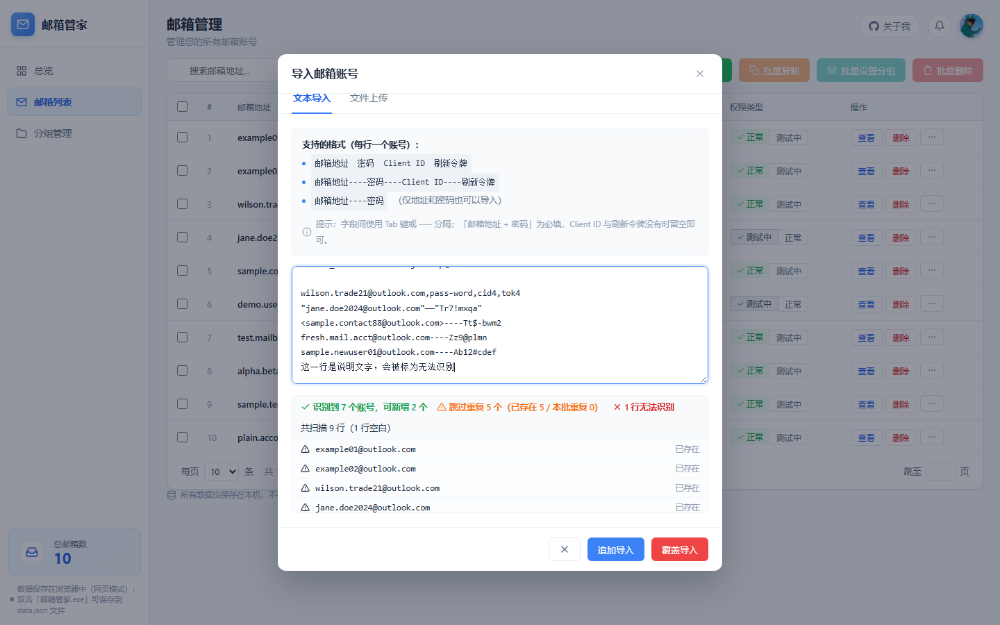
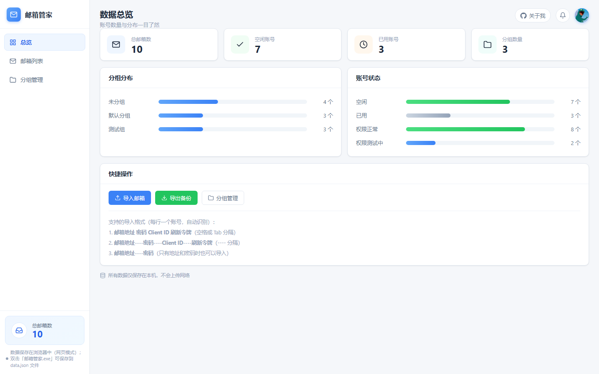

# 邮箱管家 · Mailbox Manager

一个**完全本地运行**的 Windows 邮箱账号管理小工具。

把手上零散的邮箱账号（地址、密码、Client ID、刷新令牌）一次性粘进来，程序自动识别格式；哪个用过了点一下标成「已用」，不用再翻记事本对账。

界面是单文件网页，外壳用 pywebview，可打包成一个带图标的 exe，双击即用，**目标机器不需要装 Python**。



---

## 功能

| 分类 | 说明 |
| --- | --- |
| **多格式导入** | 粘贴文本或上传 `.txt / .csv`，一行一个账号，多种写法可混排 |
| **实时预览** | 粘贴的同时显示「识别到几个 / 可新增几个 / 跳过重复几个 / 几行无法识别」，确认后再入库 |
| **追加 / 覆盖导入** | 追加保留现有账号并自动跳过重复邮箱；覆盖先清空再导入（有二次确认） |
| **状态标记** | 每行「空闲 / 已用」点击切换，总览页同步统计 |
| **权限类型** | 「正常 / 测试中」切换 |
| **密码掩码** | 默认打码，点眼睛图标才显示 |
| **分组管理** | 新建 / 重命名 / 删除分组，账号可单个或批量移动 |
| **搜索筛选分页** | 按邮箱搜索、按分组筛选、每页条数可调 |
| **批量操作** | 批量复制 / 批量设置分组 / 批量删除 |
| **账号详情** | 查看全部字段，每项一键复制 |
| **导出备份** | 全部数据导出为 JSON |
| **全程离线** | 不联网、不上传，账号数据只存在本机 |

---

## 界面预览

导入弹窗——粘贴即识别，行数、重复、无法识别的行都标得清清楚楚：



数据总览——账号数、空闲/已用、分组分布一屏看完：



---

## 快速开始

### 方式一：直接用打包好的 exe

> 本仓库**不包含**打包产物（避免仓库长期背着十几 MB 二进制），请按下面的方式自行构建，
> 或到你自己的 Releases 页面存放发布版。

双击 `邮箱管家.exe` 即可运行，无需任何运行环境，首次启动自解压约 3～8 秒。

### 方式二：从源码构建

需要 Python 3.10+（开发使用 3.13）。

```bash
pip install -r requirements.txt
python build_exe.py            # 产物在 dist/邮箱管家.exe
```

不打包、直接跑起来调试也可以：

```bash
python app.py                  # 以桌面窗口运行
```

甚至可以完全不用 Python——直接双击 `邮箱管家.html` 用浏览器打开，功能一模一样
（区别是数据存在浏览器本地存储里，不和桌面版共用）。

---

## 支持的导入格式

每行一个账号，以下写法都能识别，**并且可以混排**：

```
邮箱地址 密码 ClientID 刷新令牌          # 空格或 Tab 分隔
邮箱地址----密码----ClientID----刷新令牌  # ---- 分隔
邮箱地址----密码                        # 只有地址和密码
```

也能容忍从 Excel / 表格 / 邮件里复制出来的常见噪音：逗号或全角空格分隔、字段带引号或尖括号、
用中文破折号 `——` 连接、行首带 BOM 或零宽字符、`\r\n` 换行等。

示例（均为虚构数据）：

```
example01@outlook.com----MyPass1234
example02@outlook.com----MyPass5678----11111111-2222-3333-4444-555555555555----M.C000_XXXX.0.AbCdEf...
third@example.com   pass789   client_id   refresh_token
"quoted@outlook.com"——"pass0000"
```

解析策略是**先按分隔符切分字段、再定位含 `@` 的字段并做完整校验**，所以字段里出现连字符、
空格、特殊符号都不会串位。

---

## 数据存放

默认位置：

```
C:\Users\<用户名>\AppData\Roaming\邮箱管家\data.json
```

**便携模式**：把 `data.json` 放在 exe 同目录，程序会自动改用那一份。这样软件和数据可以一起
拷到 U 盘，换电脑接着用。

> ⚠️ `data.json` 里是明文账号密码。请注意保管，不要提交到版本库、不要随手转发。
> 本仓库的 `.gitignore` 已经排除了它。

---

## 项目结构

```
.
├── 邮箱管家.html          # 界面 + 全部交互逻辑（单文件，零外部依赖）
├── app.py                # 桌面程序入口：pywebview 窗口 + 数据读写 / 打开外链接口
├── app.ico               # 应用图标（16～256 多尺寸）
├── build_exe.py          # 一键打包脚本（PyInstaller onefile）
├── requirements.txt      # Python 依赖
├── 使用说明.txt            # 写给最终使用者的说明书
├── screenshots/          # README 用截图
└── .vscode/              # 调试 / 构建配置
```

---

## 开发者：用 VSCode 改这个项目

用 VSCode 打开本文件夹，右下角会提示安装推荐扩展（主要就是 **Python** 扩展）。

| 想做的事 | 怎么做 |
| --- | --- |
| 运行桌面窗口 | 按 `F5`，选「运行 邮箱管家（桌面窗口）」 |
| 打包成 exe | 按 `Ctrl+Shift+B` |
| 改界面 | 编辑 `邮箱管家.html`，双击它用浏览器打开看效果，`F12` 看控制台 |
| 调试界面逻辑 | 在 HTML 里插 `debugger;`，浏览器 DevTools 单步调 |

### 换成你自己的仓库信息

如果 fork 之后要挂自己的头像和仓库链接，改这两个地方的同名常量即可：

- `邮箱管家.html` 顶部：`GITHUB_USER` / `REPO_NAME`（右上角头像和「关于我」按钮都用它）
- `app.py` 顶部：`GITHUB_USER` / `REPO_NAME`（`info()` 接口会带出去）

头像优先读 GitHub 在线头像（换头像会自动变），离线时回退到 HTML 里内嵌的那份快照。

---

## 技术说明

- **界面**：原生 HTML / CSS / JS，无框架、无 CDN，样式和图标全部内联
- **外壳**：pywebview（Windows 上走 WebView2），页面通过 `js_api` 调用 Python 侧读写 `data.json`
- **打开外链**：页面调用 Python 的 `open_url()` 走 `webbrowser.open`，只放行 http/https
- **双通道存储**：检测到 `window.pywebview.api` 就写文件，否则退回 localStorage，所以浏览器直开也能用
- **打包**：PyInstaller onefile，`--collect-all webview/clr_loader/pythonnet` 带上 WebView2 相关依赖
- **降级**：依赖系统自带的 Microsoft Edge WebView2 运行时（Win11 / 较新 Win10 已预装）；
  万一缺失，程序会自动改用默认浏览器打开，功能不受影响

---

## 关于作者

- GitHub：[@Liufuyingjie](https://github.com/Liufuyingjie)
- 项目仓库：<https://github.com/Liufuyingjie/mailbox-manager>

用着有问题、或者有想加的功能，欢迎提 Issue。

---

## 免责声明

本工具仅用于管理**自己拥有或已获授权**的邮箱账号，方便本地记录使用状态。
请遵守相关服务条款，不要用于任何违规用途。账号数据由使用者自行负责保管。
